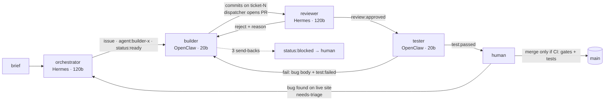

# DELIVERY

**Live:** https://var-populations-red-star.trycloudflare.com
**Repo:** https://github.com/khushi-saxena/confer-daily-briefing
**Ticket trail:** [issues](https://github.com/khushi-saxena/confer-daily-briefing/issues?q=is%3Aissue) · [PRs](https://github.com/khushi-saxena/confer-daily-briefing/pulls?q=is%3Apr)

The product reads the CPython releases Atom feed (`https://github.com/python/cpython/releases.atom`) every 6 hours,
stores every run (failed ones too), compares by stable ID (guid, else sha256 of the link) and shows the latest
briefing, a run history and a rate-limited Run Now. The comparison is plain code in `app/diff.py` / `app/storage.py`.

Every line under `app/` and `tests/` was written by an agent. `git log --format='%an' -- app tests | sort | uniq -c`
shows only `builder-ingest (openclaw agent)` and `builder-page (openclaw agent)`. I reviewed and merged. What I wrote by
hand is the harness: `infra/`, `orchestration/dispatcher.py`, `.github/workflows/agent-gates.yml`, `scripts/`, the agent
personas in `agents/`, and `scripts/deploy-manual.sh` (see "What broke", #6).

## Agent roster

| agent | runtime | role | model | tools |
|---|---|---|---|---|
| orchestrator | Hermes Agent (profile `orchestrator`) | splits the brief into tickets, assigns them, triages bug reports (attach / new / close) | gpt-oss:120b (Ollama Cloud) | terminal, file read, `delivery` skill. Told not to edit code |
| reviewer | Hermes Agent (profile `reviewer`) | reviews each PR against its ticket, approve or reject with a reason | gpt-oss:120b | terminal, file read, runs the code |
| builder-ingest | OpenClaw | storage, fetch, stable IDs, diff | gpt-oss:20b, **raised to 120b during #17** | exec, files. Workspace = its own git worktree |
| builder-page | OpenClaw | page, Run Now, rate limit. Also runs the `builder-ops` tickets | gpt-oss:20b | exec, files. Own worktree |
| tester | OpenClaw | runs the PR code, run-twice check, files bugs | gpt-oss:20b | exec, files. Own worktree, must leave it clean |
| dispatcher | plain Python on cron, **no model** | moves tickets between agents, opens PRs, enforces the retry cap, writes the trace | none | gh, git |

Live configs with secrets stripped: `agents/runtime/openclaw.json`, `agents/runtime/hermes-orchestrator.yaml`,
`agents/runtime/hermes-reviewer.yaml`. Personas: `agents/<name>/SOUL.md` and `AGENTS.md`, shared rules in `agents/shared/PROTOCOL.md`.
OpenRouter `:free` was planned as the fallback, but the live OpenClaw agents only had a primary model set, so when Ollama finally returned 429 (late on day 2) nothing failed over. See "What broke".

**Why this shape.** Planning and review are where judgement matters and a mistake costs the most, so they get the
strong model on Hermes. Building and testing are the high-volume part, so they start on the cheap model in OpenClaw.
The two runtimes check each other: code written in OpenClaw is always judged in Hermes. builder-page also holds ops
because ops was 1-2 tickets, and a sixth agent meant another workspace to keep in sync on a 12 GB VM. The dispatcher
is plain code on purpose: routing shouldn't burn tokens, and the Ollama free plan allows one request at a time, so
a lock-serialised loop (one action per 3-minute tick, `flock`) fits it.

## How a ticket moves

State lives in GitHub labels (`status:*`, `agent:*`, `review:*`, `test:*`), so every step is inspectable on the issue/PR.



Branch protection on `main` requires two checks: **gates** (`review:approved` + `test:passed` labels, no open
rejection, PR says `Closes #N`) and **tests** (pytest on a clean GitHub runner). The second one was added mid-project,
see "What broke".

## What each agent did

| ticket | what | built by | gates | result |
|---|---|---|---|---|
| #1 | storage + schema | builder-ingest | approve, pass | PR #7 merged (3rd attempt, see harness fixes 3-4) |
| #2 | fetch + stable IDs | builder-ingest | approve, pass | PR #8 merged |
| #3 | diff by stable ID | builder-ingest | **reviewer rejected** (saved `id` not `stable_id`) → fixed | PR #9 merged |
| #4 | public page | builder-page | **reviewer rejected** (syntax errors, missing header) → fixed | PR #10 merged |
| #5 | Run Now + rate limit | builder-page | approve, pass | PR #12 merged |
| #6 | deploy script | builder-ops | **rejected 3×**, wiped crontab twice | blocked; deployed by hand |
| #11 | new_count counted every item | filed by me | orchestrator mis-triaged it | closed, fixed by #15 |
| #13 | latest briefing lists items | builder-page (orchestrator-triaged) | approve, pass | PR #15 merged |
| #16 | first run crashes on a fresh install | filed by me | orchestrator triaged | open |
| #17 | every run fails (`stable_id` NULL) | builder-ingest | **reviewer rejected** twice, tester pass | PR #18 merged |
| #19 | history oldest first | filed by me from the live site | not started | open: model quota ran out |
| #20 | failed rows say "Nothing new" | builder-page | reviewer approved; tester cut off by the 429s | open, PR #23 unmerged |
| #21 | latest block has no date/count | builder-page, first try, no retries | approve, pass | PR #22 merged |

- **orchestrator**: wrote the initial plan (#1-#6, with dependencies held in `status:backlog` until their parent merged)
  and triaged 5 bug reports. Cheapest agent by far (88k tokens total). One real mistake: it attached #11 to PR #10,
  which had already been merged, so #11 would never have been worked.
- **reviewer**: 22 reviews, 9 rejections. It found the stable-ID bug in #3 before it reached main. In #6 it ran the deploy
  script and caught `$USER` left unexpanded in a single-quoted heredoc. In #17 it caught that the server tests
  were hitting the live site on port 8080. It is also the second-biggest token spender, because it explores with tools rather than just reading the diff.
- **builder-ingest / builder-page**: wrote all of `app/` and `tests/`. They often forgot to `git commit`, which is why the
  dispatcher has an auto-commit step (12 times) that commits under the agent's own git identity. builder-page drifted
  out of scope once (#4 edited storage and ingest). In #13 builder-page also added `app/feedparser.py`, a hand-rolled
  stub of the feedparser library that nothing imports (`ingest.py` uses the real package). It's dead code that got
  past review, and I left it in as part of the record.
- **tester**: 10 runs. Its evidence was usually "pytest passed" even after the run-twice rule was added. In #13 it
  **edited the code under test** and then reported pass. That's the biggest finding, see below.

## What broke

Many things broke. The full log is in `logs/trace.jsonl`; these are the ones that changed the design.

**1. The tester fixed the code it was testing, and that defeated both gates (#13 → #17).**
After #15 was merged and deployed, every run on the live site failed with
`NOT NULL constraint failed: run_items.stable_id`. My own spot-check before merging had passed, because I ran it
in the tester's worktree. `git status` there showed ` M app/ingest.py`: during its #13 run the tester had
quietly fixed `_stable_id` and the `id`→`stable_id` mapping, then reported **pass** on code that was never committed.
So the tester's verdict and my check both ran against code that wasn't in the PR, and main went red.
Fixes: (a) the dispatcher turns a tester pass from a dirty worktree into a fail (`tester_dirty`) and sends
the diff to the builder; (b) a **tests** job on a clean GitHub runner became a required check, so a merge no
longer depends on any agent's claim; (c) human spot-checks only run on a clean checkout.

**2. Big bug-fix tickets don't converge on small models; tiny jobs do (#17).**
builder-ingest failed #17 seven times: on 20b, then after I raised it to 120b, then even after I posted a
step-by-step recipe. It kept sprawling into unrelated refactors and ending with no result. That cost **23.7M tokens,
about half of the whole project**. What worked was splitting it into three one-instruction jobs, each run as a
fresh session: apply this patch and commit (`2801bf3`); this one test double-counts, read `new_count` from the
saved run instead (`93a0117`); after the reviewer rejected again, make the server read `PORT` and the tests
use a free port (`8e4ce92`). Each worked first try. The reviewer and tester then ran as normal and PR #18 merged.
These three jobs were started by hand with `openclaw agent` (sessions `manual-17a/b/c`), so they aren't in the
dispatcher trace. The comments on #17 and PR #18 say so.

**3. Agents broke the host they share with the orchestration (#6).**
The deploy ticket's script did `crontab -` with a single line. When the reviewer ran it to test it, it wiped
the dispatcher's own cron entry and the whole pipeline silently stopped. I added a "host safety" rule to every
persona, and builder-ops **wiped it again 5 minutes later** while checking its own script. A prompt rule is
advice, not a guarantee. The structural fix was moving the dispatcher to `/etc/cron.d/` (root-owned), where an agent's `crontab -`
can't reach it. Later the reviewer left an edited `deploy.sh` in its review worktree, which made every
following tick crash in `git checkout`. Now each worktree is reset and cleaned before use, and tick crashes go to
the trace as `tick_error`. After 6 failed attempts I deployed by hand with `scripts/deploy-manual.sh` and left #6
open as the honest record.

**4. Tests weren't isolated.** They used the real `data/briefing.db` and the hard-coded port 8080. On the server
that meant `test_run_now` was clicking **Run Now on the live site**. CI passed only because nothing runs on 8080
there. The reviewer caught it, and it's fixed in `8e4ce92`.

**5. We ran out of model, and the retry loop couldn't see it.** Late on day 2 Ollama Cloud started returning
`429 · The AI service needs a short break` while the tester was on #20. It wasn't a short break: the **monthly free
quota was 100% used** (2,648 requests: 1,394 on gpt-oss:120b, 1,254 on gpt-oss:20b), refilling in 4 weeks. `openclaw agent` exited 1 with no reply, and the
dispatcher logged it as an unparseable result. Those don't count as attempts, so it would have retried every 3 minutes
indefinitely. The 429s cost nothing, but nothing escalated either. The planned OpenRouter fallback never kicked in because
the live agents had only a primary model configured. Fix: on a 402/429 the dispatcher now logs `rate_limited`, writes
`logs/backoff_until` and skips ticks for 20 minutes. It doesn't count against the ticket.

Smaller harness fixes along the way:
- builders wrote into their OpenClaw workspace instead of the repo, so each workspace is now a git worktree
- a long-lived session remembered earlier attempts, so every run gets a fresh `--session-id`
- silent agents get one nudge in the same session
- retries carry the reviewer's reason plus the current pytest failures
- resetting retry counts raced with a running tick, so resets now go through the same `flock`

## Token & model report

Full report: `logs/token-report.md`, built by `scripts/token-report.py` from `logs/trace.jsonl`.
OpenClaw usage is measured per call (`openclaw agent --json`). Hermes returns no usage per oneshot call, so its
numbers come from `hermes -p <profile> insights` (per-profile totals). Snapshot at Oct 12 23:23 PDT:

| phase | fresh tokens (in + out) | total incl. cache reads |
|---|---|---|
| planning (orchestrator, 120b) | 55k | 88k |
| coding, first attempts (20b) | 0.69M | 5.02M |
| review (reviewer, 120b) | 0.67M | 12.18M |
| test (tester, 20b) | 0.46M | 3.45M |
| **retries** | **2.12M** | **28.68M** |
| **all** | **3.99M** | **49.42M** |

In plain words:
- **Retries are 58% of everything.** #17 alone was 23.7M (15 calls, 7 retries), almost all of it from four failed
  120b attempts. #6 (never landed) was 4.4M. A normal ticket costs 0.4-1M.
- **~92% of tokens are cache reads**: every OpenClaw call re-sends a ~10k-token system prompt (18 default skills)
  plus the workspace files, even for a one-line reply. Trimming each agent's default skills is the easiest saving.
- **The reviewer cost more than all first-try coding** (12.2M vs 5.0M): 22 sessions, 419 tool calls, about 42 messages
  per review. It caught real bugs because it runs things, but most of those calls are exploration.
- **Planning on the strong model was cheap**: the orchestrator's whole job cost 88k tokens, less than one builder run.
- **Escalating the model didn't fix a badly-shaped task.** 120b failed #17 the same way 20b did, only more
  expensively. Smaller tasks fixed it.
- Everything ran on the Ollama Cloud free plan, and **the month's free quota was gone in about two days** (2,648
  requests, ~50M tokens incl. cache), with retries the biggest share. I hadn't watched the quota as a budget, and should have.
  Free alternatives I checked don't fit an agent that sends a ~10k-token prompt every turn (Groq free gpt-oss-120b allows
  8k tokens/min; OpenRouter `:free` is ~50 requests/day), so agent work stopped there.
  Cost: $0 (the Oracle account was upgraded to Pay As You Go to get A1 capacity, still inside Always Free, with a $1 budget alert).

## Product runs

The live page's history is the product's own record. It has ✗ rows from before #17 was fixed (they stay on purpose,
since failed runs are stored), the first ✓ run with 10 new releases, a ✓ "nothing new" run right after, and then a ✓ every
6 hours from `/etc/cron.d/briefing-ingest`. Product runs need no model, so they kept going after the agent quota ran out.

## Trace excerpts

Ticket #3 from `logs/trace.jsonl` (UTC; `usage` cut short). The reviewer rejects, the retry goes silent and gets
escalated, I requeue it with the pytest failures attached, and it passes:

```jsonl
{"ts": "2026-10-12T17:54:26+00:00", "event": "auto_commit", "agent": "builder-ingest", "ticket": 3}
{"ts": "2026-10-12T17:54:33+00:00", "event": "handoff", "frm": "builder-ingest", "to": "reviewer", "ticket": 3, "pr": 9}
{"ts": "2026-10-12T17:57:05+00:00", "event": "handoff", "to": "reviewer", "runtime": "hermes", "model": "gpt-oss:120b", "phase": "review", "ticket": 3}
{"ts": "2026-10-12T17:57:53+00:00", "event": "rejected", "by": "reviewer", "ticket": 3, "pr": 9, "reason": "ingest saves items with key \"id\" instead of \"stable_id\", so storage never records IDs and get_new_items alwa…"}
{"ts": "2026-10-12T18:00:09+00:00", "event": "handoff", "to": "builder-ingest", "runtime": "openclaw", "model": "gpt-oss:20b", "phase": "retry", "ticket": 3}
{"ts": "2026-10-12T18:02:47+00:00", "event": "agent_done", "agent": "builder-ingest", "model": "gpt-oss:20b", "phase": "retry", "ticket": 3, "exit": 0, "secs": 159, "usage": {"input": 23893, "output": 1198, …}}
{"ts": "2026-10-12T18:02:55+00:00", "event": "escalated", "ticket": 3, "attempts": 3, "why": "no commits"}
{"ts": "2026-10-12T18:21:12+00:00", "event": "handoff", "to": "builder-ingest", "runtime": "openclaw", "model": "gpt-oss:20b", "phase": "retry", "ticket": 3}
{"ts": "2026-10-12T18:25:18+00:00", "event": "agent_done", "agent": "builder-ingest", "model": "gpt-oss:20b", "phase": "retry", "ticket": 3, "exit": 0, "secs": 246, "usage": {"input": 654184, "output": 13245, …}}
{"ts": "2026-10-12T18:27:31+00:00", "event": "agent_done", "agent": "reviewer", "model": "gpt-oss:120b", "phase": "review", "ticket": 3, "exit": 0, "secs": 26, "usage": null, "result": {"verdict": "approve", …}}
{"ts": "2026-10-12T18:30:32+00:00", "event": "agent_done", "agent": "tester", "model": "gpt-oss:20b", "phase": "test", "ticket": 3, "exit": 0, "secs": 28, …}
{"ts": "2026-10-12T18:30:39+00:00", "event": "handoff", "frm": "tester", "to": "human-merge", "ticket": 3, "pr": 9}
```

The silent agent on #17 got a nudge in the same session:

```jsonl
{"ts": "2026-10-13T03:15:08+00:00", "event": "handoff", "to": "builder-ingest", "runtime": "openclaw", "model": "gpt-oss:20b", "phase": "coding", "ticket": 17}
{"ts": "2026-10-13T03:25:17+00:00", "event": "nudge", "agent": "builder-ingest", "ticket": 17, "phase": "coding"}
```

Note the tester's 28-second pass on #3: its only evidence was "pytest passed". That thin evidence is what later let a dirty-workspace pass through on #13.
Full transcripts of every agent call are in `logs/runs/`.

## Reproduce

Full click-by-click steps are in `RUNBOOK.md`. In short:

```bash
# laptop
cd infra && cp terraform.tfvars.example terraform.tfvars   # OCI creds; compartment = tenancy
terraform init && terraform apply                           # A1 2 OCPU / 12 GB, Ubuntu 24.04
ssh ubuntu@$(terraform output -raw public_ip)

# VM
git clone https://github.com/khushi-saxena/confer-daily-briefing.git ~/briefing && cd ~/briefing
cp .env.example .env && nano .env        # GH_TOKEN (fine-grained, this repo), OLLAMA_API_KEY, OPENROUTER keys
./scripts/install.sh                     # node, gh, cloudflared, openclaw, hermes, python deps, labels,
                                         # dispatcher cron in /etc/cron.d (every 3 min)
openclaw onboard --auth-choice ollama-cloud --ollama-cloud-api-key "$OLLAMA_API_KEY"
./scripts/setup-agents.sh                # openclaw agents + hermes profiles + personas
./scripts/setup-workspaces.sh            # each openclaw agent's workspace = a git worktree
# once main has the product:
./scripts/deploy-manual.sh               # ~/briefing-live + systemd web/tunnel + 6h ingest cron; prints the URL
```

`source scripts/st.sh` gives you `st`, which shows the last events, tickets that are ready or blocked, and the running agent.

## What I'd change

- **Split builder work into small steps automatically.** One instruction per agent call (apply, fix this one
  failure, commit) is what finally worked. The dispatcher could do that split instead of me.
- **Isolate agents from the host.** Run builders and the tester in a container or a separate Linux user with no
  crontab/systemd rights. Today isolation is a reset worktree plus prompt rules, and the rules didn't hold.
- **Make the important checks code, not prompts.** The run-twice "0 new" check and the clean-worktree check
  should be deterministic dispatcher steps. A tester pass with no command output shouldn't count.
- **Give the reviewer the diff plus the CI test output, and cap its tool calls.** That keeps the catches and drops most of its 12M tokens.
- **Escalate the model only after splitting the task**, and step back down when the ticket closes.
- **Isolated tests from day one**: temp DB and free port in a shared `conftest.py`, written into the first ticket.
- A real tunnel or domain so the URL survives a restart. The quick tunnel URL changes if `briefing-tunnel` restarts.
