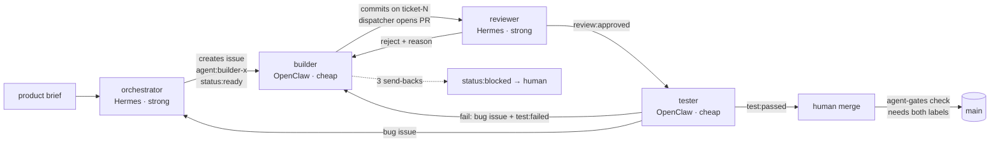

# DELIVERY

> Template. Fill each TODO from real evidence (issues, PRs, logs/trace.jsonl, logs/token-report.md).
> Don't fill anything in ahead of time. Confer grades honesty here.

**Live:** TODO trycloudflare URL
**Repo:** TODO

## Agent roster

| agent | runtime | role | model (fallback) | tools |
|---|---|---|---|---|
| orchestrator | Hermes Agent (profile) | splits brief into tickets, assigns, triages bugs | STRONG_MODEL (FALLBACK_STRONG) | terminal, file read; no code edits by instruction |
| reviewer | Hermes Agent (profile) | reads each PR against its ticket, approve/reject | STRONG_MODEL (FALLBACK_STRONG) | terminal, file read |
| builder-ingest | OpenClaw | storage, fetch, stable IDs, diff, CLI, synthetic feed | CHEAP_MODEL (FALLBACK_CHEAP) | exec, files |
| builder-page | OpenClaw | page, run-now + rate limit; also holds builder-ops | CHEAP_MODEL (FALLBACK_CHEAP) | exec, files |
| tester | OpenClaw | runs it, two-run "0 new" check, opens bug tickets | CHEAP_MODEL (FALLBACK_CHEAP) | exec, files |
| dispatcher | Python on cron, **no model** | moves tickets between agents, enforces retry cap | none | gh, git |

**Why this shape.** Planning and review are where judgement matters and where a mistake is
expensive, so they get the strong model on Hermes. Building and testing are high-volume and
well-specified, so they go on a cheap model in OpenClaw. builder-page also holds ops because
ops is 1-2 small tickets and a sixth agent would mean another workspace to keep in sync on a
12 GB VM. The dispatcher is plain code on purpose: routing shouldn't burn tokens, and the
Ollama free tier allows one request at a time, so a lock-serialised loop fits it exactly.

## How a ticket moves



## What each agent actually did
TODO per agent: tickets touched (#links), PRs, rejections given/received. Pull from `gh issue list` and the trace.

## One thing that broke
TODO: what happened, which gate caught it (link the rejection comment), what the retry changed (link the commit).

## Token & model report
TODO: paste/summarise logs/token-report.md. Split: planning / coding / review / test / retries.
Say in plain words where the tokens went. Mark estimates as estimates.

## Trace excerpts
TODO: 5-10 real lines from logs/trace.jsonl showing a handoff, a rejection and the retry.

## Reproduce

```bash
cd infra && cp terraform.tfvars.example terraform.tfvars   # fill in OCI creds
terraform init && terraform apply
ssh ubuntu@$(terraform output -raw public_ip)
git clone <repo> ~/briefing && cd ~/briefing
cp .env.example .env                                        # fill in keys
./scripts/install.sh                                        # runtimes + agents + dispatcher cron
# product deploy (written by the agents):
./scripts/deploy.sh
```

## What I'd change
TODO
